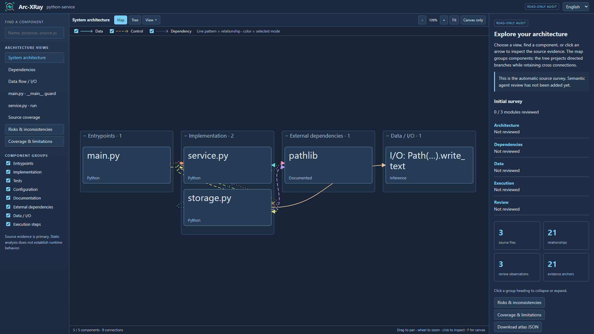

<p align="center"></p>
<h1 align="center">Arc-XRay</h1>
<p align="center">Independent architecture analysis. One interactive blue atlas.</p>

[Русский](README.ru.md) · [Guide](docs/USAGE.md) · [Capabilities](docs/CAPABILITIES.md)

Arc-XRay is a **standalone skills plugin**, with no MCP server, connector or API
key requirement. An agent reads project source, investigates architecture and
produces a source-backed interactive **index.html**. Chat, Work and browser viewing
use the **same packaged renderer and complete data model**.

## Install in the application

Download/build `dist/arc-xray-0.2.0.zip`, then choose **Plugins → Add → Upload plugin
archive**. Select Arc-XRay in a new chat. The ZIP contains the skill, Python runtime,
HTML/CSS/JS viewer and original icon. Its Skills page displays the agent instructions;
the executable code and viewer live in supporting files within that same skill.

When replacing 0.1.0, remove the old Arc-XRay installation and import the new archive
if your app offers no replacement action. The new plugin has no MCP registration.
Do not edit installed caches. Your generated atlases stay separate from the plugin.

## Terminal installation

**Windows PowerShell 5.1 or newer** — run these lines (no `&&`):

```powershell
codex plugin marketplace add ConstantineJJ/Arc-XRay
if ($LASTEXITCODE -eq 0) { codex plugin add arc-xray@arc-xray }
```

**Bash / Git Bash / Linux / macOS**:

```bash
codex plugin marketplace add ConstantineJJ/Arc-XRay && codex plugin add arc-xray@arc-xray
```

The optional source installers are `install.ps1` and `install.sh`. Both support
DryRun/--dry-run, preserve other plugins and use supported Codex CLI commands.
A host Python 3.10+ and actual source access are needed for analysis; installation
alone does not grant access to a local disk or install a runtime in Chat.

## Ask the agent

> Use Arc-XRay to perform a full read-only source architecture review. Investigate
> all five areas, trace success and failure paths, and deliver the canonical blue
> index.html, the same in-app HTML preview, evidence and editable diagrams.

The workflow starts with a survey and continues through semantic source review.
A **completion gate** requires all five areas, implementation module descriptions
and execution paths. A survey/partial result cannot pass finalization. This checks
recorded review coverage, not runtime correctness or infallibility.

## Features

- System architecture, dependencies, data/storage, execution and architectural review.
- Source-backed observations of errors, contradictions, redundancy, coupling,
  possible efficiency problems and other risks; assumptions/unknowns stay visible.
- Blue map/tree UI, zoom/pan, search, expandable groups, relationship filters,
  readable labels, canvas-only mode and source inspectors.
- Single/bulk Markdown/JSON finding logs, Save As where supported, download fallback.
- Autonomous index.html, atlas.json, REPORT.md, COMPONENTS.md, draw.io and Mermaid.
- English/Russian controls and generated review text. Agent prose follows the user's language.



## Reproducible local example

From the repository root, in PowerShell:

```powershell
python .\arc-xray.py audit .\examples\python-service --out .\.test-output\demo --enrichment .\examples\python-review.json --language ru --finalize
Invoke-Item .\.test-output\demo\index.html
```

In Bash:

```bash
python3 -B arc-xray.py audit examples/python-service --out .test-output/demo --enrichment examples/python-review.json --finalize
```

For another project, the agent supplies its real accessible paths. Commands with
literal `<plugin-root>` placeholders are not executable examples. Running `audit`
without semantic review creates an explicitly labeled survey, not a full audit.

## One preview, honest access limits

Open the generated index.html in a browser or the host's HTML artifact preview.
The plugin never needs a separate MCP panel and never substitutes a new simplified
HTML design. If a host cannot expose packaged files, read sources or run Python,
the agent must say what is missing rather than invent a graph. Preview/download
controls depend on the host. A plain textual reply is not atlas acceptance.

Python imports use AST; JS/TS, GDScript, Go, Rust and C# have lexical import adapters.
Other source types receive inventory coverage and need agent interpretation.
Dynamic dispatch, generated code and runtime behavior are not fully reconstructed.
No project code is executed or fixed; no benchmarks are invented.

## Development

```bash
python3 -B -m unittest discover -s tests -v
npm ci
npx playwright install chromium
npm run test:ui
python3 -B scripts/package.py
```

Runtime is Python standard-library only. Node/Playwright are development tools.
[Verification](docs/VERIFICATION.md) · [MIT](LICENSE)
